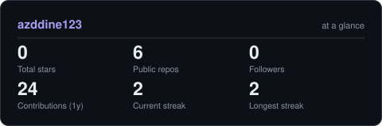
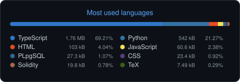

<!-- BANNER - terminal profile.sh --live. Generated by scripts/banner.py. -->
<picture>
  <source media="(prefers-color-scheme: dark)" srcset="assets/banner-dark.svg">
  <source media="(prefers-color-scheme: light)" srcset="assets/banner-light.svg">
  
</picture>

 

<!-- NAME / TAGLINE - animated typing -->

 

<!-- SOCIALS -->
&nbsp;&nbsp;
&nbsp;&nbsp;

 

---

## This is me :)

Hi, I'm **Azddine**, AI & cybersecurity engineering student at ENSA Béni Mellal, broadcasting from Morocco 🇲🇦.
I like building where AI meets security: systems that spot threats early, protect data,
and still stay simple for the people who use them.

- 🛡️ **Cybersecurity Intern at [1337 Coding School](https://1337.ma) (LEET Solutions)**: built a SIEM platform that detects Kerberos attacks in Active Directory (ELK pipeline + Sigma rules mapped to MITRE ATT&CK, 7 attack scenarios validated).
- 📱 **Mobile Software Engineer Intern at GM Soft**: shipped LabCollect Mobile, an offline-first React Native app secured with Keycloak (OAuth 2.0 + PKCE, biometric login).
- 🚑 Currently building **NAJDA**: decision support for humanitarian logistics after disasters (AHP + TOPSIS + VRP with OR-Tools, -16.5% routing cost) for the MTSPC26 competition.
- 🧠 Built **[PicLearn](https://github.com/azddine123/PicLearn)**: an AI study assistant that turns photos of course notes into summaries, quizzes and flashcards (OCR + LLM + RAG).
- 🎯 **Looking for:** a 4 to 6 month PFE internship from February 2027 in **Generative AI** or **defensive cybersecurity / SOC**.
- 💬 Talk to me about **threat detection, LLMs and RAG** and you'll have my full attention.
 

## my perfect stack`

---

## signals

<table>
<tr>
<td width="50%" align="center" valign="middle">

<!-- Self-rated radar - edit assets/skills.json, the workflow redraws it -->
<picture>
  <source media="(prefers-color-scheme: dark)" srcset="assets/radar-dark.svg">
  <source media="(prefers-color-scheme: light)" srcset="assets/radar-light.svg">
  
</picture>

</td>
<td width="50%" align="center" valign="middle">

<!-- Language stack radar - edit assets/langmix.json -->
<picture>
  <source media="(prefers-color-scheme: dark)" srcset="assets/radar-langs-dark.svg">
  <source media="(prefers-color-scheme: light)" srcset="assets/radar-langs-light.svg">
  
</picture>

</td>
</tr>
</table>

---

## Numbers matter? ohhh yes.

<!-- Generated by scripts/cards.py (self-hosted, refreshed daily by .github/workflows/cards.yml) -->
<picture>
  <source media="(prefers-color-scheme: dark)" srcset="assets/card-stats-dark.svg">
  <source media="(prefers-color-scheme: light)" srcset="assets/card-stats-light.svg">
  
</picture>

 

<picture>
  <source media="(prefers-color-scheme: dark)" srcset="assets/languages-dark.svg">
  <source media="(prefers-color-scheme: light)" srcset="assets/languages-light.svg">
  
</picture>

---

` Built with love · @azddine123 `

